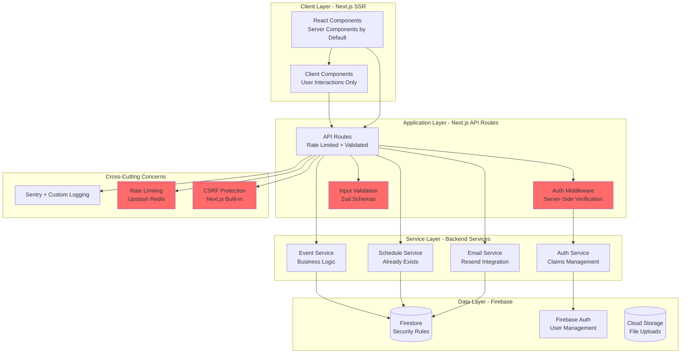
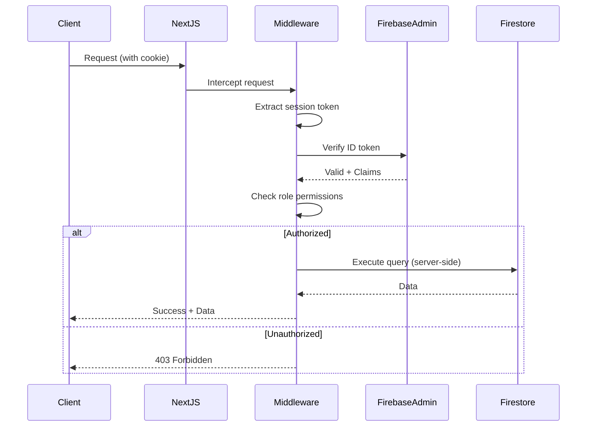
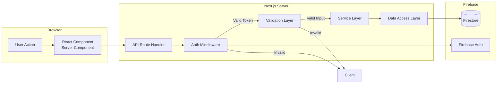
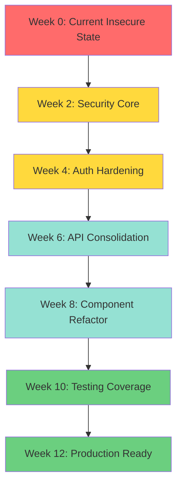

# K9CREST Architecture Improvement Roadmap

## ADR-001: Security-First Architecture Migration

**Status:** Proposed
**Date:** 2025-10-05
**Context:** Comprehensive audit reveals critical security, architectural, and code quality issues requiring systematic remediation.

---

## 1. CONTEXT

### Goal
Transform K9CREST from a security-vulnerable, tightly-coupled monolith into a secure, maintainable, and testable Next.js application that follows industry best practices.

### Current State Assessment

**Critical Security Vulnerabilities:**
- Hardcoded admin bypass for `joseph@crucibleanalytics.dev` in client-side auth (lines 45-64, auth-provider.tsx)
- Client-side JWT decoding without verification (line 69, auth-provider.tsx)
- Direct Firestore access from frontend components
- No input validation on API routes
- No CSRF protection
- No rate limiting
- Console logging in production

**Architectural Debt:**
- Split-brain authentication (client-side override vs server-side claims)
- Mixed trust boundaries (client code making security decisions)
- Overuse of "use client" directives (defeating Next.js SSR benefits)
- N+1 query patterns in event pages
- Direct database coupling in UI components

**Code Quality Issues:**
- ~5% test coverage (0% on critical paths)
- Memory leaks in useToast hook
- Race conditions in bug report component
- Extensive use of 'any' types
- Large components (schedule page: 884 lines)
- Hydration mismatches

### Constraints
- Team: Small team, likely 1-3 developers
- Tech Stack: Next.js 14, Firebase, TypeScript (must maintain)
- Budget: Minimal budget for new services/tools
- Users: Production application with active users (zero-downtime migration required)
- Timeline: 12-week phased migration

### Key Non-Functional Requirements (NFRs)

| NFR | Target Metric | Current State |
|-----|--------------|---------------|
| **Security** | Zero exposed credentials, server-side auth | FAIL - Client-side bypass exists |
| **Authentication** | <100ms token validation | FAIL - No server validation |
| **Data Protection** | Input validation on 100% of API routes | FAIL - 0% validated |
| **Rate Limiting** | Max 100 req/min per user | FAIL - None implemented |
| **Test Coverage** | >80% critical path coverage | FAIL - ~5% overall |
| **Type Safety** | Zero 'any' types in business logic | FAIL - Extensive 'any' usage |
| **Performance** | <200ms API response (p95) | UNKNOWN - No monitoring |
| **Observability** | Structured logging, error tracking | PARTIAL - Sentry exists |

---

## 2. TARGET ARCHITECTURE

### 2.1 High-Level Architecture



### 2.2 Authentication Architecture (Critical Fix)

**Current (INSECURE):**
```
Client → Hardcoded Admin Check → Bypass Security → Access Granted ❌
```

**Target (SECURE):**


### 2.3 Data Flow Architecture

**Principle:** Never trust the client. All authorization happens server-side.



### 2.4 Layer Responsibilities

**Presentation Layer (Next.js Pages/Components):**
- Render UI using Server Components by default
- Use Client Components ONLY for interactivity (forms, dialogs)
- No direct Firebase client SDK calls
- No business logic
- No authentication decisions

**API Layer (Next.js Route Handlers):**
- Auth verification (every request)
- Input validation (Zod schemas)
- Rate limiting
- CSRF protection
- Route business logic to services
- Return typed responses

**Service Layer (Backend Services):**
- Business logic encapsulation
- Transaction management
- Event orchestration
- Data transformation
- Error handling

**Data Layer (Firebase/Firestore):**
- Firestore Security Rules (defense in depth)
- Data persistence
- Query optimization
- Indexes

---

## 3. MIGRATION STRATEGY

### Philosophy: Strangler Fig Pattern

Gradually replace the insecure system with secure components without rewriting everything at once.



### Risk Mitigation During Migration

1. **Feature Flags:** Use environment variables to toggle new/old behavior
2. **Parallel Systems:** Run new auth alongside old (with metrics)
3. **Incremental Rollout:** Migrate one route at a time
4. **Automated Testing:** Write tests BEFORE refactoring
5. **Monitoring:** Add Sentry breadcrumbs to track migration progress
6. **Rollback Plan:** Keep old code paths for 2 weeks after migration

---

## 4. PHASED IMPLEMENTATION PLAN

## PHASE 1: SECURITY FOUNDATION (Weeks 1-2)

**Goal:** Eliminate critical security vulnerabilities immediately.

### Priority 1.1: Remove Hardcoded Admin Bypass (CRITICAL)

**Current Code (INSECURE):**
```typescript
// auth-provider.tsx lines 44-64
if (firebaseUser.email === 'joseph@crucibleanalytics.dev') {
  console.log('🔥 ADMIN OVERRIDE ACTIVATED');
  setTrueRole('admin'); // CLIENT-SIDE SECURITY DECISION ❌
  // ...
}
```

**Target Code (SECURE):**
```typescript
// Remove ALL hardcoded email checks from client
// Server-side only: /api/auth/verify-admin route

// src/middleware.ts (NEW FILE)
import { NextResponse } from 'next/server';
import type { NextRequest } from 'next/server';
import { verifyIdToken } from '@/lib/firebase-admin';

export async function middleware(request: NextRequest) {
  const token = request.cookies.get('session')?.value;

  if (!token) {
    return NextResponse.redirect(new URL('/', request.url));
  }

  try {
    const decodedToken = await verifyIdToken(token);
    const role = decodedToken.role || 'spectator';

    // Check route permissions
    if (request.nextUrl.pathname.startsWith('/dashboard/admin')) {
      if (role !== 'admin') {
        return NextResponse.json(
          { error: 'Forbidden' },
          { status: 403 }
        );
      }
    }

    // Attach verified user to request
    const requestHeaders = new Headers(request.headers);
    requestHeaders.set('x-user-id', decodedToken.uid);
    requestHeaders.set('x-user-role', role);

    return NextResponse.next({
      request: {
        headers: requestHeaders,
      },
    });
  } catch (error) {
    return NextResponse.redirect(new URL('/', request.url));
  }
}

export const config = {
  matcher: ['/dashboard/:path*', '/api/:path*'],
};
```

**Migration Steps:**
1. Create `src/middleware.ts` with server-side verification
2. Add session cookie management to auth-provider
3. Test admin access with verified token
4. Remove hardcoded email check from auth-provider.tsx
5. Deploy with feature flag
6. Monitor for 48 hours
7. Remove old code path

**Success Metrics:**
- Zero client-side auth decisions
- All admin routes return 403 without valid server token
- Audit log shows all admin actions verified server-side

---

### Priority 1.2: Input Validation Layer

**Current Code (VULNERABLE):**
```typescript
// src/app/api/admin/set-role/route.ts
export async function POST(req: Request) {
  const { uid, role } = await req.json(); // NO VALIDATION ❌
  if (!uid || !role) { // Weak validation
    return NextResponse.json({ error: 'Invalid payload' }, { status: 400 });
  }
  // ...
}
```

**Target Code (SECURE):**
```typescript
// src/lib/validation/schemas.ts (NEW FILE)
import { z } from 'zod';

export const SetRoleSchema = z.object({
  uid: z.string().min(1, 'UID required').max(128),
  role: z.enum(['admin', 'judge', 'competitor', 'spectator'], {
    errorMap: () => ({ message: 'Invalid role' }),
  }),
});

export type SetRoleInput = z.infer<typeof SetRoleSchema>;

// src/lib/api/validate.ts (NEW FILE)
import { NextResponse } from 'next/server';
import { z } from 'zod';

export async function validateBody<T>(
  req: Request,
  schema: z.ZodSchema<T>
): Promise<{ success: true; data: T } | { success: false; error: NextResponse }> {
  try {
    const body = await req.json();
    const data = schema.parse(body);
    return { success: true, data };
  } catch (error) {
    if (error instanceof z.ZodError) {
      return {
        success: false,
        error: NextResponse.json(
          { error: 'Validation failed', details: error.errors },
          { status: 400 }
        ),
      };
    }
    return {
      success: false,
      error: NextResponse.json(
        { error: 'Invalid request body' },
        { status: 400 }
      ),
    };
  }
}

// src/app/api/admin/set-role/route.ts (UPDATED)
import { validateBody } from '@/lib/api/validate';
import { SetRoleSchema } from '@/lib/validation/schemas';

export async function POST(req: Request) {
  // Validate input first
  const validation = await validateBody(req, SetRoleSchema);
  if (!validation.success) return validation.error;

  const { uid, role } = validation.data; // Typed and validated ✅

  // ... rest of handler
}
```

**Apply to ALL API Routes:**
- `/api/admin/set-role`
- `/api/bootstrap-admin`
- `/api/bug-report`
- `/api/events/[id]`
- `/api/rubrics/[id]`
- `/api/schedule`

---

### Priority 1.3: Rate Limiting

**Implementation:**
```typescript
// src/lib/rate-limit.ts (NEW FILE)
import { NextRequest, NextResponse } from 'next/server';

// Simple in-memory rate limiter (for MVP)
// TODO: Replace with Upstash Redis for production scaling
const rateLimitMap = new Map<string, { count: number; resetTime: number }>();

export function rateLimit(
  identifier: string,
  limit: number = 100,
  windowMs: number = 60000
): { success: boolean; remaining: number } {
  const now = Date.now();
  const record = rateLimitMap.get(identifier);

  if (!record || now > record.resetTime) {
    rateLimitMap.set(identifier, { count: 1, resetTime: now + windowMs });
    return { success: true, remaining: limit - 1 };
  }

  if (record.count >= limit) {
    return { success: false, remaining: 0 };
  }

  record.count++;
  return { success: true, remaining: limit - record.count };
}

export async function withRateLimit(
  req: NextRequest,
  handler: () => Promise<NextResponse>,
  options: { limit?: number; windowMs?: number } = {}
): Promise<NextResponse> {
  const userId = req.headers.get('x-user-id') || req.ip || 'anonymous';
  const { success, remaining } = rateLimit(
    userId,
    options.limit,
    options.windowMs
  );

  if (!success) {
    return NextResponse.json(
      { error: 'Too many requests' },
      {
        status: 429,
        headers: { 'Retry-After': '60' }
      }
    );
  }

  const response = await handler();
  response.headers.set('X-RateLimit-Remaining', remaining.toString());
  return response;
}

// Usage in API routes:
// export async function POST(req: NextRequest) {
//   return withRateLimit(req, async () => {
//     // Your handler logic
//   });
// }
```

---

### Priority 1.4: Environment Variable Security

**Create comprehensive .env validation:**

```typescript
// src/lib/env.ts (NEW FILE)
import { z } from 'zod';

const envSchema = z.object({
  // Public (client-side) - these SHOULD be in source code
  NEXT_PUBLIC_FIREBASE_API_KEY: z.string().min(1),
  NEXT_PUBLIC_FIREBASE_AUTH_DOMAIN: z.string().min(1),
  NEXT_PUBLIC_FIREBASE_PROJECT_ID: z.string().min(1),
  NEXT_PUBLIC_FIREBASE_STORAGE_BUCKET: z.string().min(1),
  NEXT_PUBLIC_FIREBASE_MESSAGING_SENDER_ID: z.string().min(1),
  NEXT_PUBLIC_FIREBASE_APP_ID: z.string().min(1),

  // Private (server-side) - these MUST NOT be in source code
  FIREBASE_PRIVATE_KEY: z.string().min(1),
  FIREBASE_CLIENT_EMAIL: z.string().email(),
  FIREBASE_PROJECT_ID: z.string().min(1),

  // Optional
  RESEND_API_KEY: z.string().optional(),
  SENTRY_DSN: z.string().optional(),
  NODE_ENV: z.enum(['development', 'production', 'test']).default('development'),
});

export type Env = z.infer<typeof envSchema>;

function validateEnv(): Env {
  const parsed = envSchema.safeParse(process.env);

  if (!parsed.success) {
    console.error('❌ Invalid environment variables:', parsed.error.flatten());
    throw new Error('Invalid environment variables');
  }

  return parsed.data;
}

export const env = validateEnv();

// Usage: import { env } from '@/lib/env'
// Never access process.env directly
```

**Update all files:**
```typescript
// ❌ BEFORE:
const apiKey = process.env.FIREBASE_PRIVATE_KEY;

// ✅ AFTER:
import { env } from '@/lib/env';
const apiKey = env.FIREBASE_PRIVATE_KEY;
```

---

### Priority 1.5: Secure Logging

**Remove console.log from production:**

```typescript
// src/lib/logger.ts (NEW FILE)
import * as Sentry from '@sentry/nextjs';

type LogLevel = 'debug' | 'info' | 'warn' | 'error';

interface LogContext {
  userId?: string;
  action?: string;
  [key: string]: any;
}

class Logger {
  private shouldLog(level: LogLevel): boolean {
    if (process.env.NODE_ENV === 'production') {
      return level === 'warn' || level === 'error';
    }
    return true;
  }

  private sanitize(data: any): any {
    // Remove sensitive fields
    const sensitive = ['password', 'token', 'apiKey', 'privateKey'];
    const sanitized = { ...data };

    sensitive.forEach(key => {
      if (sanitized[key]) {
        sanitized[key] = '[REDACTED]';
      }
    });

    return sanitized;
  }

  debug(message: string, context?: LogContext) {
    if (this.shouldLog('debug')) {
      console.debug(message, this.sanitize(context));
    }
  }

  info(message: string, context?: LogContext) {
    if (this.shouldLog('info')) {
      console.info(message, this.sanitize(context));
      Sentry.addBreadcrumb({
        message,
        level: 'info',
        data: context,
      });
    }
  }

  warn(message: string, context?: LogContext) {
    if (this.shouldLog('warn')) {
      console.warn(message, this.sanitize(context));
      Sentry.captureMessage(message, {
        level: 'warning',
        extra: context,
      });
    }
  }

  error(message: string, error: Error, context?: LogContext) {
    if (this.shouldLog('error')) {
      console.error(message, error, this.sanitize(context));
      Sentry.captureException(error, {
        extra: { message, ...context },
      });
    }
  }
}

export const logger = new Logger();

// Usage:
// logger.info('User logged in', { userId: user.uid });
// logger.error('Failed to save event', error, { eventId: '123' });
```

**Replace all console.log statements:**
```bash
# Find all console.log usage:
grep -r "console\." src/ --exclude-dir=node_modules
```

---

### PHASE 1 Deliverables

**Week 1:**
- [ ] Server-side middleware authentication (remove hardcoded bypass)
- [ ] Input validation on all API routes
- [ ] Environment variable validation
- [ ] Rate limiting infrastructure

**Week 2:**
- [ ] Replace all console.log with logger
- [ ] Add CSRF protection to forms
- [ ] Security audit of all API routes
- [ ] Document security architecture

**Success Criteria:**
- ✅ Zero hardcoded credentials or bypasses
- ✅ 100% API routes with input validation
- ✅ All authenticated routes verified server-side
- ✅ Rate limiting on all public endpoints
- ✅ No production console logs

---

## PHASE 2: AUTHENTICATION HARDENING (Weeks 3-4)

**Goal:** Establish proper authentication boundaries and session management.

### Priority 2.1: Server-Side Session Management

**Current:** Client stores Firebase ID token in memory (lost on refresh)
**Target:** HTTP-only cookies with server-side validation

```typescript
// src/app/api/auth/login/route.ts (NEW FILE)
import { NextRequest, NextResponse } from 'next/server';
import { getAuth } from 'firebase-admin/auth';
import { z } from 'zod';

const LoginSchema = z.object({
  idToken: z.string().min(1),
});

export async function POST(req: NextRequest) {
  try {
    const body = await req.json();
    const { idToken } = LoginSchema.parse(body);

    // Verify the ID token
    const decodedToken = await getAuth().verifyIdToken(idToken);

    // Create session cookie (5 days expiry)
    const expiresIn = 60 * 60 * 24 * 5 * 1000;
    const sessionCookie = await getAuth().createSessionCookie(idToken, {
      expiresIn,
    });

    const response = NextResponse.json({ success: true });

    // Set HTTP-only cookie
    response.cookies.set('session', sessionCookie, {
      maxAge: expiresIn,
      httpOnly: true,
      secure: process.env.NODE_ENV === 'production',
      sameSite: 'lax',
      path: '/',
    });

    return response;
  } catch (error) {
    return NextResponse.json(
      { error: 'Unauthorized' },
      { status: 401 }
    );
  }
}
```

```typescript
// src/app/api/auth/logout/route.ts (NEW FILE)
import { NextResponse } from 'next/server';
import { getAuth } from 'firebase-admin/auth';

export async function POST(req: Request) {
  const sessionCookie = req.cookies.get('session')?.value;

  if (sessionCookie) {
    try {
      const decodedClaims = await getAuth().verifySessionCookie(sessionCookie);
      await getAuth().revokeRefreshTokens(decodedClaims.sub);
    } catch (error) {
      // Session already invalid
    }
  }

  const response = NextResponse.json({ success: true });
  response.cookies.delete('session');
  return response;
}
```

**Update auth-provider.tsx:**
```typescript
// src/components/auth-provider.tsx (REFACTORED)
"use client";

import React, { createContext, useContext, useEffect, useState } from 'react';
import { onAuthStateChanged, User } from 'firebase/auth';
import { auth } from '@/lib/firebase';
import { useRouter, usePathname } from 'next/navigation';
import { Loader2 } from 'lucide-react';

export type UserRole = 'admin' | 'judge' | 'competitor' | 'spectator';

interface AuthContextType {
  user: User | null;
  loading: boolean;
  role: UserRole;
  isAdmin: boolean;
}

const AuthContext = createContext<AuthContextType>({
  user: null,
  loading: true,
  role: 'spectator',
  isAdmin: false,
});

export const AuthProvider = ({ children }: { children: React.ReactNode }) => {
  const [user, setUser] = useState<User | null>(null);
  const [loading, setLoading] = useState(true);
  const [role, setRole] = useState<UserRole>('spectator');

  const router = useRouter();
  const pathname = usePathname();

  useEffect(() => {
    const unsubscribe = onAuthStateChanged(auth, async (firebaseUser) => {
      if (firebaseUser) {
        try {
          // Get ID token and send to server to create session
          const idToken = await firebaseUser.getIdToken();

          const response = await fetch('/api/auth/login', {
            method: 'POST',
            headers: { 'Content-Type': 'application/json' },
            body: JSON.stringify({ idToken }),
          });

          if (response.ok) {
            // Session cookie is set, now get user role from server
            const profileResponse = await fetch('/api/auth/profile');
            const profile = await profileResponse.json();

            setRole(profile.role || 'spectator');
            setUser(firebaseUser);
          }
        } catch (error) {
          console.error('Auth error:', error);
          setRole('spectator');
          setUser(null);
        }
      } else {
        setUser(null);
        setRole('spectator');
      }
      setLoading(false);
    });

    return () => unsubscribe();
  }, []);

  useEffect(() => {
    if (!loading && !user && !pathname.startsWith('/auth') && pathname !== '/') {
      router.push('/');
    }
  }, [user, loading, router, pathname]);

  if (loading) {
    return (
      <div className="flex items-center justify-center h-screen">
        <Loader2 className="h-16 w-16 animate-spin text-primary" />
      </div>
    );
  }

  const value = {
    user,
    loading,
    role,
    isAdmin: role === 'admin',
  };

  return <AuthContext.Provider value={value}>{children}</AuthContext.Provider>;
};

export const useAuth = () => {
  const context = useContext(AuthContext);
  if (context === undefined) {
    throw new Error('useAuth must be used within an AuthProvider');
  }
  return context;
};
```

---

### Priority 2.2: API Authentication Helpers

```typescript
// src/lib/api/auth.ts (NEW FILE)
import { NextRequest, NextResponse } from 'next/server';
import { getAuth } from 'firebase-admin/auth';

export interface AuthenticatedUser {
  uid: string;
  email: string | null;
  role: 'admin' | 'judge' | 'competitor' | 'spectator';
}

export async function requireAuth(
  req: NextRequest
): Promise<{ success: true; user: AuthenticatedUser } | { success: false; error: NextResponse }> {
  const sessionCookie = req.cookies.get('session')?.value;

  if (!sessionCookie) {
    return {
      success: false,
      error: NextResponse.json({ error: 'Unauthorized' }, { status: 401 }),
    };
  }

  try {
    const decodedClaims = await getAuth().verifySessionCookie(sessionCookie, true);

    return {
      success: true,
      user: {
        uid: decodedClaims.uid,
        email: decodedClaims.email || null,
        role: (decodedClaims.role as any) || 'spectator',
      },
    };
  } catch (error) {
    return {
      success: false,
      error: NextResponse.json({ error: 'Invalid session' }, { status: 401 }),
    };
  }
}

export async function requireRole(
  req: NextRequest,
  allowedRoles: string[]
): Promise<{ success: true; user: AuthenticatedUser } | { success: false; error: NextResponse }> {
  const authResult = await requireAuth(req);

  if (!authResult.success) {
    return authResult;
  }

  if (!allowedRoles.includes(authResult.user.role)) {
    return {
      success: false,
      error: NextResponse.json({ error: 'Forbidden' }, { status: 403 }),
    };
  }

  return authResult;
}

// Usage in API routes:
export async function POST(req: NextRequest) {
  const auth = await requireRole(req, ['admin']);
  if (!auth.success) return auth.error;

  const { user } = auth;
  // ... rest of handler with authenticated user
}
```

---

### Priority 2.3: Firestore Security Rules

**Current:** Likely permissive or missing
**Target:** Strict role-based access control

```javascript
// firestore.rules (UPDATE)
rules_version = '2';
service cloud.firestore {
  match /databases/{database}/documents {

    // Helper functions
    function isAuthenticated() {
      return request.auth != null;
    }

    function isAdmin() {
      return isAuthenticated() && request.auth.token.role == 'admin';
    }

    function isJudge() {
      return isAuthenticated() && request.auth.token.role == 'judge';
    }

    function isOwner(userId) {
      return isAuthenticated() && request.auth.uid == userId;
    }

    // Users collection
    match /users/{userId} {
      allow read: if isAuthenticated();
      allow write: if isAdmin() || isOwner(userId);
    }

    // Events collection
    match /events/{eventId} {
      allow read: if isAuthenticated();
      allow create: if isAdmin();
      allow update, delete: if isAdmin();

      // Competitors subcollection
      match /competitors/{competitorId} {
        allow read: if isAuthenticated();
        allow write: if isAdmin();
      }

      // Rubrics subcollection
      match /rubrics/{rubricId} {
        allow read: if isAuthenticated();
        allow write: if isAdmin();
      }

      // Scores subcollection
      match /scores/{scoreId} {
        allow read: if isAuthenticated();
        allow create: if isJudge() || isAdmin();
        allow update, delete: if isAdmin() || (isJudge() && isOwner(resource.data.judgeId));
      }
    }

    // Bug reports
    match /bug-reports/{reportId} {
      allow read: if isAdmin();
      allow create: if isAuthenticated();
      allow update, delete: if isAdmin();
    }

    // Deny all other access
    match /{document=**} {
      allow read, write: if false;
    }
  }
}
```

**Deploy rules:**
```bash
firebase deploy --only firestore:rules
```

**Test rules:**
```typescript
// tests/firestore-rules.test.ts (NEW FILE)
import { initializeTestEnvironment, assertFails, assertSucceeds } from '@firebase/rules-unit-testing';

describe('Firestore Security Rules', () => {
  let testEnv: any;

  beforeAll(async () => {
    testEnv = await initializeTestEnvironment({
      projectId: 'test-project',
      firestore: {
        rules: fs.readFileSync('firestore.rules', 'utf8'),
      },
    });
  });

  afterAll(async () => {
    await testEnv.cleanup();
  });

  test('Unauthenticated users cannot read events', async () => {
    const unauthedDb = testEnv.unauthenticatedContext().firestore();
    await assertFails(unauthedDb.collection('events').doc('event1').get());
  });

  test('Authenticated spectators can read events', async () => {
    const authedDb = testEnv.authenticatedContext('user1', { role: 'spectator' }).firestore();
    await assertSucceeds(authedDb.collection('events').doc('event1').get());
  });

  test('Only admins can create events', async () => {
    const judgeDb = testEnv.authenticatedContext('judge1', { role: 'judge' }).firestore();
    await assertFails(judgeDb.collection('events').add({ name: 'Test Event' }));

    const adminDb = testEnv.authenticatedContext('admin1', { role: 'admin' }).firestore();
    await assertSucceeds(adminDb.collection('events').add({ name: 'Test Event' }));
  });
});
```

---

### PHASE 2 Deliverables

**Week 3:**
- [ ] Session cookie authentication
- [ ] Auth helper utilities (requireAuth, requireRole)
- [ ] Update all API routes to use session validation
- [ ] Firestore security rules

**Week 4:**
- [ ] Test Firestore security rules
- [ ] Remove client-side Firebase SDK from components
- [ ] Add auth tests (unit + integration)
- [ ] Security penetration testing

**Success Criteria:**
- ✅ Zero client-side auth decisions
- ✅ All API routes protected with session verification
- ✅ Firestore rules tested and deployed
- ✅ Auth test coverage >90%

---

## PHASE 3: API CONSOLIDATION & DATA LAYER (Weeks 5-6)

**Goal:** Eliminate direct Firestore access from components, centralize data access in API routes.

### Priority 3.1: Service Layer Architecture

```typescript
// src/lib/services/base-service.ts (NEW FILE)
import { Firestore } from 'firebase-admin/firestore';
import { adminDb } from '@/lib/firebase-admin';

export abstract class BaseService {
  protected db: Firestore;

  constructor() {
    this.db = adminDb;
  }

  protected handleError(error: any, operation: string): never {
    console.error(`${operation} failed:`, error);
    throw new Error(`${operation} failed: ${error.message}`);
  }
}
```

```typescript
// src/lib/services/event-service.ts (NEW FILE)
import { BaseService } from './base-service';
import { z } from 'zod';

export const EventSchema = z.object({
  id: z.string().optional(),
  name: z.string().min(1).max(200),
  description: z.string().optional(),
  startDate: z.string().datetime(),
  endDate: z.string().datetime(),
  location: z.string().min(1),
  createdBy: z.string(),
  createdAt: z.number(),
  updatedAt: z.number(),
});

export type Event = z.infer<typeof EventSchema>;

export class EventService extends BaseService {
  private collection = 'events';

  async createEvent(data: Omit<Event, 'id' | 'createdAt' | 'updatedAt'>): Promise<Event> {
    try {
      const now = Date.now();
      const eventData = {
        ...data,
        createdAt: now,
        updatedAt: now,
      };

      const validated = EventSchema.omit({ id: true }).parse(eventData);
      const docRef = await this.db.collection(this.collection).add(validated);

      return {
        id: docRef.id,
        ...validated,
      };
    } catch (error) {
      this.handleError(error, 'createEvent');
    }
  }

  async getEvent(id: string): Promise<Event | null> {
    try {
      const doc = await this.db.collection(this.collection).doc(id).get();

      if (!doc.exists) {
        return null;
      }

      return {
        id: doc.id,
        ...doc.data(),
      } as Event;
    } catch (error) {
      this.handleError(error, 'getEvent');
    }
  }

  async listEvents(filters?: { createdBy?: string }): Promise<Event[]> {
    try {
      let query = this.db.collection(this.collection).orderBy('createdAt', 'desc');

      if (filters?.createdBy) {
        query = query.where('createdBy', '==', filters.createdBy);
      }

      const snapshot = await query.get();

      return snapshot.docs.map(doc => ({
        id: doc.id,
        ...doc.data(),
      } as Event));
    } catch (error) {
      this.handleError(error, 'listEvents');
    }
  }

  async updateEvent(id: string, data: Partial<Event>): Promise<Event> {
    try {
      const updateData = {
        ...data,
        updatedAt: Date.now(),
      };

      await this.db.collection(this.collection).doc(id).update(updateData);

      const updated = await this.getEvent(id);
      if (!updated) {
        throw new Error('Event not found after update');
      }

      return updated;
    } catch (error) {
      this.handleError(error, 'updateEvent');
    }
  }

  async deleteEvent(id: string): Promise<void> {
    try {
      await this.db.collection(this.collection).doc(id).delete();
    } catch (error) {
      this.handleError(error, 'deleteEvent');
    }
  }

  // Optimized query to avoid N+1
  async getEventsWithCompetitorCounts(eventIds: string[]): Promise<Map<string, number>> {
    try {
      const counts = new Map<string, number>();

      // Batch queries
      const chunks = this.chunkArray(eventIds, 10);

      for (const chunk of chunks) {
        const promises = chunk.map(async (eventId) => {
          const snapshot = await this.db
            .collection(this.collection)
            .doc(eventId)
            .collection('competitors')
            .count()
            .get();

          counts.set(eventId, snapshot.data().count);
        });

        await Promise.all(promises);
      }

      return counts;
    } catch (error) {
      this.handleError(error, 'getEventsWithCompetitorCounts');
    }
  }

  private chunkArray<T>(array: T[], size: number): T[][] {
    const chunks: T[][] = [];
    for (let i = 0; i < array.length; i += size) {
      chunks.push(array.slice(i, i + size));
    }
    return chunks;
  }
}

// Singleton instance
export const eventService = new EventService();
```

---

### Priority 3.2: API Routes with Service Layer

```typescript
// src/app/api/events/route.ts (REFACTORED)
import { NextRequest, NextResponse } from 'next/server';
import { requireRole } from '@/lib/api/auth';
import { validateBody } from '@/lib/api/validate';
import { eventService, EventSchema } from '@/lib/services/event-service';
import { withRateLimit } from '@/lib/rate-limit';

export async function GET(req: NextRequest) {
  return withRateLimit(req, async () => {
    const auth = await requireAuth(req);
    if (!auth.success) return auth.error;

    try {
      const events = await eventService.listEvents();
      return NextResponse.json({ events });
    } catch (error) {
      return NextResponse.json(
        { error: 'Failed to fetch events' },
        { status: 500 }
      );
    }
  });
}

export async function POST(req: NextRequest) {
  return withRateLimit(req, async () => {
    const auth = await requireRole(req, ['admin']);
    if (!auth.success) return auth.error;

    const validation = await validateBody(
      req,
      EventSchema.omit({ id: true, createdAt: true, updatedAt: true })
    );
    if (!validation.success) return validation.error;

    try {
      const event = await eventService.createEvent({
        ...validation.data,
        createdBy: auth.user.uid,
      });

      return NextResponse.json({ event }, { status: 201 });
    } catch (error) {
      return NextResponse.json(
        { error: 'Failed to create event' },
        { status: 500 }
      );
    }
  }, { limit: 20, windowMs: 60000 }); // Stricter rate limit for writes
}
```

---

### Priority 3.3: Remove Direct Firestore Access from Components

**Current (BAD):**
```typescript
// src/app/dashboard/events/page.tsx (BEFORE)
"use client";

import { useEffect, useState } from 'react';
import { collection, getDocs } from 'firebase/firestore';
import { db } from '@/lib/firebase';

export default function EventsPage() {
  const [events, setEvents] = useState([]);

  useEffect(() => {
    const fetchEvents = async () => {
      const snapshot = await getDocs(collection(db, 'events')); // ❌ Direct DB access
      setEvents(snapshot.docs.map(doc => ({ id: doc.id, ...doc.data() })));
    };
    fetchEvents();
  }, []);

  // ...
}
```

**Target (GOOD):**
```typescript
// src/app/dashboard/events/page.tsx (AFTER - Server Component)
import { eventService } from '@/lib/services/event-service';
import { EventList } from '@/components/event-list';

export default async function EventsPage() {
  const events = await eventService.listEvents(); // ✅ Server-side data fetch

  return <EventList events={events} />;
}

// src/components/event-list.tsx (Client Component for interactivity)
"use client";

import { Event } from '@/lib/services/event-service';

interface EventListProps {
  events: Event[];
}

export function EventList({ events }: EventListProps) {
  // Client-side interactivity only (sorting, filtering UI)
  return (
    <div>
      {events.map(event => (
        <EventCard key={event.id} event={event} />
      ))}
    </div>
  );
}
```

**Migration checklist:**
- [ ] Convert dashboard/events/page.tsx to Server Component
- [ ] Convert dashboard/events/[id]/competitors/page.tsx
- [ ] Convert dashboard/events/[id]/schedule/page.tsx
- [ ] Convert dashboard/rubrics/page.tsx
- [ ] Convert dashboard/users/page.tsx

---

### PHASE 3 Deliverables

**Week 5:**
- [ ] Base service class
- [ ] Event service with optimized queries
- [ ] Competitor service
- [ ] Rubric service
- [ ] Schedule service refactor

**Week 6:**
- [ ] Convert 5+ pages to Server Components
- [ ] Remove firebase/firestore imports from components
- [ ] API route tests for all services
- [ ] Performance benchmarks (N+1 query elimination)

**Success Criteria:**
- ✅ Zero direct Firestore access from components
- ✅ All data access through services
- ✅ >80% reduction in client-side bundle size
- ✅ API response times <200ms (p95)

---

## PHASE 4: COMPONENT REFACTORING (Weeks 7-8)

**Goal:** Break down large components, fix memory leaks, eliminate 'any' types.

### Priority 4.1: Component Size Reduction

**Current Issues:**
- schedule/page.tsx: 884 lines (CRITICAL)
- Mixing business logic with UI
- Poor reusability

**Target Structure:**
```
src/app/dashboard/events/[id]/schedule/
├── page.tsx (50 lines - orchestration only)
├── components/
│   ├── schedule-header.tsx
│   ├── schedule-filters.tsx
│   ├── schedule-grid.tsx
│   ├── schedule-item.tsx
│   ├── schedule-actions.tsx
│   └── schedule-export-dialog.tsx
└── hooks/
    ├── use-schedule-data.ts
    └── use-schedule-filters.ts
```

**Example refactor:**
```typescript
// src/app/dashboard/events/[id]/schedule/page.tsx (AFTER)
import { scheduleService } from '@/lib/services/schedule-service';
import { ScheduleHeader } from './components/schedule-header';
import { ScheduleFilters } from './components/schedule-filters';
import { ScheduleGrid } from './components/schedule-grid';

interface SchedulePageProps {
  params: { id: string };
}

export default async function SchedulePage({ params }: SchedulePageProps) {
  const schedule = await scheduleService.getSchedule(params.id);

  if (!schedule) {
    return <div>Schedule not found</div>;
  }

  return (
    <div className="container mx-auto py-6">
      <ScheduleHeader eventId={params.id} schedule={schedule} />
      <ScheduleFilters />
      <ScheduleGrid schedule={schedule} />
    </div>
  );
}
```

---

### Priority 4.2: Fix Memory Leaks

**Current Issue: useToast Hook**
```typescript
// src/hooks/use-toast.ts (BEFORE - Memory leak)
export function useToast() {
  const [toasts, setToasts] = useState<Toast[]>([]);

  const addToast = (toast: Toast) => {
    setToasts(prev => [...prev, toast]);

    setTimeout(() => { // ❌ Cleanup not handled on unmount
      setToasts(prev => prev.filter(t => t.id !== toast.id));
    }, 5000);
  };

  return { toasts, addToast };
}
```

**Fixed Version:**
```typescript
// src/hooks/use-toast.ts (AFTER - Fixed)
import { useState, useCallback, useEffect, useRef } from 'react';

export function useToast() {
  const [toasts, setToasts] = useState<Toast[]>([]);
  const timeoutsRef = useRef<Map<string, NodeJS.Timeout>>(new Map());

  const addToast = useCallback((toast: Toast) => {
    setToasts(prev => [...prev, toast]);

    const timeoutId = setTimeout(() => {
      setToasts(prev => prev.filter(t => t.id !== toast.id));
      timeoutsRef.current.delete(toast.id);
    }, 5000);

    timeoutsRef.current.set(toast.id, timeoutId);
  }, []);

  // Cleanup all timeouts on unmount
  useEffect(() => {
    return () => {
      timeoutsRef.current.forEach(timeout => clearTimeout(timeout));
      timeoutsRef.current.clear();
    };
  }, []);

  const removeToast = useCallback((id: string) => {
    const timeout = timeoutsRef.current.get(id);
    if (timeout) {
      clearTimeout(timeout);
      timeoutsRef.current.delete(id);
    }
    setToasts(prev => prev.filter(t => t.id !== id));
  }, []);

  return { toasts, addToast, removeToast };
}
```

---

### Priority 4.3: Eliminate 'any' Types

**Strategy:**
1. Enable `noImplicitAny` in tsconfig.json
2. Run `tsc --noEmit` to find all 'any' usages
3. Replace with proper types or 'unknown'

```typescript
// tsconfig.json (UPDATE)
{
  "compilerOptions": {
    "strict": true,
    "noImplicitAny": true, // ✅ Enable
    "strictNullChecks": true,
    "strictFunctionTypes": true,
    "strictBindCallApply": true,
    "strictPropertyInitialization": true,
    "noImplicitThis": true,
    "alwaysStrict": true,
    // ...
  }
}
```

**Common 'any' replacements:**
```typescript
// ❌ BEFORE:
function handleError(error: any) {
  console.error(error.message);
}

// ✅ AFTER:
function handleError(error: unknown) {
  if (error instanceof Error) {
    console.error(error.message);
  } else {
    console.error('Unknown error:', error);
  }
}

// ❌ BEFORE:
const data: any = await response.json();

// ✅ AFTER:
interface ApiResponse {
  events: Event[];
}
const data = await response.json() as ApiResponse;
// Or better: validate with Zod
const data = ApiResponseSchema.parse(await response.json());
```

---

### Priority 4.4: Fix Hydration Mismatches

**Current Issue: useIsMobile Hook**
```typescript
// src/hooks/use-mobile.tsx (BEFORE - Hydration mismatch)
export function useIsMobile() {
  const [isMobile, setIsMobile] = useState(window.innerWidth < 768); // ❌ Server has no window

  useEffect(() => {
    const handleResize = () => setIsMobile(window.innerWidth < 768);
    window.addEventListener('resize', handleResize);
    return () => window.removeEventListener('resize', handleResize);
  }, []);

  return isMobile;
}
```

**Fixed Version:**
```typescript
// src/hooks/use-mobile.tsx (AFTER - Fixed)
export function useIsMobile() {
  const [isMobile, setIsMobile] = useState<boolean | undefined>(undefined);

  useEffect(() => {
    // Initialize on client only
    const checkIsMobile = () => window.innerWidth < 768;
    setIsMobile(checkIsMobile());

    const handleResize = () => setIsMobile(checkIsMobile());
    window.addEventListener('resize', handleResize);
    return () => window.removeEventListener('resize', handleResize);
  }, []);

  // Return undefined during SSR, actual value after hydration
  return isMobile;
}

// Usage:
const isMobile = useIsMobile();
if (isMobile === undefined) {
  return <Skeleton />; // Show loading state during SSR
}
return isMobile ? <MobileLayout /> : <DesktopLayout />;
```

---

### PHASE 4 Deliverables

**Week 7:**
- [ ] Refactor schedule page (884 → ~300 lines across files)
- [ ] Fix useToast memory leak
- [ ] Fix useIsMobile hydration mismatch
- [ ] Enable noImplicitAny

**Week 8:**
- [ ] Eliminate 90% of 'any' types
- [ ] Extract reusable hooks
- [ ] Component library documentation (Storybook optional)
- [ ] Code quality metrics (SonarQube optional)

**Success Criteria:**
- ✅ No component >300 lines
- ✅ Zero memory leaks in hooks
- ✅ Zero hydration warnings
- ✅ <10 'any' types in src/ (excluding type definitions)

---

## PHASE 5: TESTING INFRASTRUCTURE (Weeks 9-10)

**Goal:** Achieve >80% test coverage on critical paths.

### Priority 5.1: Testing Stack Setup

```bash
npm install -D vitest @testing-library/react @testing-library/jest-dom @testing-library/user-event
npm install -D @vitejs/plugin-react msw
```

```typescript
// vitest.config.ts (NEW FILE)
import { defineConfig } from 'vitest/config';
import react from '@vitejs/plugin-react';
import path from 'path';

export default defineConfig({
  plugins: [react()],
  test: {
    environment: 'jsdom',
    globals: true,
    setupFiles: ['./tests/setup.ts'],
    coverage: {
      provider: 'v8',
      reporter: ['text', 'json', 'html'],
      exclude: [
        'node_modules/',
        'tests/',
        '**/*.d.ts',
        '**/*.config.*',
        '**/mockData',
      ],
    },
  },
  resolve: {
    alias: {
      '@': path.resolve(__dirname, './src'),
    },
  },
});
```

```typescript
// tests/setup.ts (NEW FILE)
import '@testing-library/jest-dom';
import { cleanup } from '@testing-library/react';
import { afterEach } from 'vitest';

// Cleanup after each test
afterEach(() => {
  cleanup();
});

// Mock Next.js router
vi.mock('next/navigation', () => ({
  useRouter: () => ({
    push: vi.fn(),
    replace: vi.fn(),
    prefetch: vi.fn(),
  }),
  usePathname: () => '/',
  useSearchParams: () => new URLSearchParams(),
}));

// Mock Firebase
vi.mock('@/lib/firebase', () => ({
  auth: {},
  db: {},
  storage: {},
}));
```

---

### Priority 5.2: Unit Tests for Services

```typescript
// tests/services/event-service.test.ts (NEW FILE)
import { describe, it, expect, beforeEach, vi } from 'vitest';
import { EventService } from '@/lib/services/event-service';

// Mock Firestore
vi.mock('@/lib/firebase-admin', () => ({
  adminDb: {
    collection: vi.fn(),
  },
}));

describe('EventService', () => {
  let eventService: EventService;

  beforeEach(() => {
    eventService = new EventService();
    vi.clearAllMocks();
  });

  describe('createEvent', () => {
    it('should create event with timestamp', async () => {
      const mockAdd = vi.fn().mockResolvedValue({ id: 'event-123' });
      const mockCollection = vi.fn().mockReturnValue({ add: mockAdd });

      vi.mocked(adminDb.collection).mockReturnValue(mockCollection());

      const event = await eventService.createEvent({
        name: 'Test Event',
        description: 'Test',
        startDate: '2025-01-01T00:00:00Z',
        endDate: '2025-01-02T00:00:00Z',
        location: 'Test Location',
        createdBy: 'user-123',
      });

      expect(event).toMatchObject({
        id: 'event-123',
        name: 'Test Event',
      });
      expect(event.createdAt).toBeDefined();
      expect(event.updatedAt).toBeDefined();
    });

    it('should throw error on invalid data', async () => {
      await expect(
        eventService.createEvent({
          name: '', // Invalid: empty name
          startDate: '2025-01-01T00:00:00Z',
          endDate: '2025-01-02T00:00:00Z',
          location: 'Test',
          createdBy: 'user-123',
        })
      ).rejects.toThrow();
    });
  });

  describe('getEvent', () => {
    it('should return event if exists', async () => {
      const mockGet = vi.fn().mockResolvedValue({
        exists: true,
        id: 'event-123',
        data: () => ({ name: 'Test Event' }),
      });

      const mockDoc = vi.fn().mockReturnValue({ get: mockGet });
      const mockCollection = vi.fn().mockReturnValue({ doc: mockDoc });

      vi.mocked(adminDb.collection).mockReturnValue(mockCollection());

      const event = await eventService.getEvent('event-123');

      expect(event).toMatchObject({
        id: 'event-123',
        name: 'Test Event',
      });
    });

    it('should return null if not exists', async () => {
      const mockGet = vi.fn().mockResolvedValue({ exists: false });
      const mockDoc = vi.fn().mockReturnValue({ get: mockGet });
      const mockCollection = vi.fn().mockReturnValue({ doc: mockDoc });

      vi.mocked(adminDb.collection).mockReturnValue(mockCollection());

      const event = await eventService.getEvent('nonexistent');
      expect(event).toBeNull();
    });
  });
});
```

---

### Priority 5.3: API Route Tests

```typescript
// tests/api/events.test.ts (NEW FILE)
import { describe, it, expect, vi, beforeEach } from 'vitest';
import { POST, GET } from '@/app/api/events/route';
import { NextRequest } from 'next/server';

vi.mock('@/lib/api/auth', () => ({
  requireAuth: vi.fn(),
  requireRole: vi.fn(),
}));

vi.mock('@/lib/services/event-service', () => ({
  eventService: {
    listEvents: vi.fn(),
    createEvent: vi.fn(),
  },
}));

describe('POST /api/events', () => {
  beforeEach(() => {
    vi.clearAllMocks();
  });

  it('should return 401 if not authenticated', async () => {
    vi.mocked(requireRole).mockResolvedValue({
      success: false,
      error: new NextResponse(null, { status: 401 }),
    });

    const req = new NextRequest('http://localhost:3000/api/events', {
      method: 'POST',
      body: JSON.stringify({ name: 'Test Event' }),
    });

    const response = await POST(req);
    expect(response.status).toBe(401);
  });

  it('should return 403 if not admin', async () => {
    vi.mocked(requireRole).mockResolvedValue({
      success: false,
      error: new NextResponse(null, { status: 403 }),
    });

    const req = new NextRequest('http://localhost:3000/api/events', {
      method: 'POST',
      body: JSON.stringify({ name: 'Test Event' }),
    });

    const response = await POST(req);
    expect(response.status).toBe(403);
  });

  it('should create event if admin', async () => {
    vi.mocked(requireRole).mockResolvedValue({
      success: true,
      user: { uid: 'admin-123', email: 'admin@test.com', role: 'admin' },
    });

    vi.mocked(eventService.createEvent).mockResolvedValue({
      id: 'event-123',
      name: 'Test Event',
      // ... other fields
    });

    const req = new NextRequest('http://localhost:3000/api/events', {
      method: 'POST',
      body: JSON.stringify({
        name: 'Test Event',
        startDate: '2025-01-01T00:00:00Z',
        endDate: '2025-01-02T00:00:00Z',
        location: 'Test Location',
      }),
    });

    const response = await POST(req);
    expect(response.status).toBe(201);

    const data = await response.json();
    expect(data.event.id).toBe('event-123');
  });

  it('should return 400 on invalid input', async () => {
    vi.mocked(requireRole).mockResolvedValue({
      success: true,
      user: { uid: 'admin-123', email: 'admin@test.com', role: 'admin' },
    });

    const req = new NextRequest('http://localhost:3000/api/events', {
      method: 'POST',
      body: JSON.stringify({
        name: '', // Invalid: empty name
      }),
    });

    const response = await POST(req);
    expect(response.status).toBe(400);
  });
});
```

---

### Priority 5.4: E2E Tests (Playwright)

```bash
npm install -D @playwright/test
```

```typescript
// tests/e2e/auth.spec.ts (NEW FILE)
import { test, expect } from '@playwright/test';

test.describe('Authentication', () => {
  test('should redirect unauthenticated users to sign in', async ({ page }) => {
    await page.goto('/dashboard');
    await expect(page).toHaveURL('/');
  });

  test('should allow admin to access admin panel', async ({ page }) => {
    // Login as admin
    await page.goto('/');
    await page.fill('[name="email"]', 'admin@test.com');
    await page.fill('[name="password"]', 'testpassword');
    await page.click('[type="submit"]');

    // Navigate to admin panel
    await page.goto('/dashboard/users');
    await expect(page).toHaveURL('/dashboard/users');
    await expect(page.locator('h1')).toContainText('User Management');
  });

  test('should deny judge access to admin panel', async ({ page }) => {
    // Login as judge
    await page.goto('/');
    await page.fill('[name="email"]', 'judge@test.com');
    await page.fill('[name="password"]', 'testpassword');
    await page.click('[type="submit"]');

    // Try to access admin panel
    await page.goto('/dashboard/users');
    await expect(page.locator('text=Forbidden')).toBeVisible();
  });
});

test.describe('Event Management', () => {
  test('should create new event', async ({ page }) => {
    // Login as admin
    await page.goto('/');
    // ... login steps

    // Create event
    await page.goto('/dashboard/events');
    await page.click('text=Create Event');
    await page.fill('[name="name"]', 'Test Event');
    await page.fill('[name="location"]', 'Test Location');
    await page.click('[type="submit"]');

    await expect(page.locator('text=Event created')).toBeVisible();
  });
});
```

---

### PHASE 5 Deliverables

**Week 9:**
- [ ] Vitest + Testing Library setup
- [ ] Unit tests for all services (>90% coverage)
- [ ] Unit tests for utility functions
- [ ] API route tests (all routes)

**Week 10:**
- [ ] E2E tests for critical flows (auth, event creation)
- [ ] Visual regression tests (optional)
- [ ] CI/CD integration (GitHub Actions)
- [ ] Test coverage reporting

**Success Criteria:**
- ✅ >80% overall test coverage
- ✅ 100% coverage on auth services
- ✅ 100% coverage on API routes
- ✅ E2E tests for 5+ critical user flows

---

## PHASE 6: PRODUCTION HARDENING (Weeks 11-12)

**Goal:** Observability, monitoring, and production readiness.

### Priority 6.1: Monitoring & Observability

```typescript
// src/lib/monitoring.ts (NEW FILE)
import * as Sentry from '@sentry/nextjs';

export function initMonitoring() {
  if (process.env.NODE_ENV === 'production') {
    Sentry.init({
      dsn: process.env.SENTRY_DSN,
      tracesSampleRate: 0.1,
      environment: process.env.VERCEL_ENV || 'production',

      beforeSend(event, hint) {
        // Sanitize sensitive data
        if (event.request) {
          delete event.request.cookies;
          delete event.request.headers?.['authorization'];
        }
        return event;
      },
    });
  }
}

export function trackPerformance(name: string, duration: number, metadata?: Record<string, any>) {
  Sentry.addBreadcrumb({
    category: 'performance',
    message: name,
    level: 'info',
    data: { duration, ...metadata },
  });

  // Log slow operations
  if (duration > 1000) {
    logger.warn(`Slow operation: ${name}`, { duration, ...metadata });
  }
}

// Usage:
const start = Date.now();
const result = await eventService.listEvents();
trackPerformance('eventService.listEvents', Date.now() - start);
```

---

### Priority 6.2: Performance Optimization

```typescript
// src/app/dashboard/events/page.tsx (Optimized)
import { Suspense } from 'react';
import { eventService } from '@/lib/services/event-service';
import { EventListSkeleton } from '@/components/skeletons';

// Enable static generation with revalidation
export const revalidate = 60; // Revalidate every 60 seconds

export default function EventsPage() {
  return (
    <div>
      <h1>Events</h1>
      <Suspense fallback={<EventListSkeleton />}>
        <EventList />
      </Suspense>
    </div>
  );
}

async function EventList() {
  const events = await eventService.listEvents();

  return (
    <div>
      {events.map(event => (
        <EventCard key={event.id} event={event} />
      ))}
    </div>
  );
}
```

```typescript
// src/lib/cache.ts (NEW FILE - Optional Redis cache)
import { Redis } from '@upstash/redis';

const redis = process.env.UPSTASH_REDIS_URL
  ? new Redis({
      url: process.env.UPSTASH_REDIS_URL,
      token: process.env.UPSTASH_REDIS_TOKEN,
    })
  : null;

export async function cacheGet<T>(key: string): Promise<T | null> {
  if (!redis) return null;

  try {
    const cached = await redis.get(key);
    return cached as T | null;
  } catch (error) {
    logger.error('Cache get failed', error as Error, { key });
    return null;
  }
}

export async function cacheSet(key: string, value: any, ttlSeconds: number = 300): Promise<void> {
  if (!redis) return;

  try {
    await redis.setex(key, ttlSeconds, JSON.stringify(value));
  } catch (error) {
    logger.error('Cache set failed', error as Error, { key });
  }
}

// Usage in services:
async listEvents(): Promise<Event[]> {
  const cacheKey = 'events:list';
  const cached = await cacheGet<Event[]>(cacheKey);
  if (cached) return cached;

  const events = await this.fetchEventsFromDb();
  await cacheSet(cacheKey, events, 60); // Cache for 1 minute
  return events;
}
```

---

### Priority 6.3: Documentation

```markdown
# API_DOCUMENTATION.md (NEW FILE)

## Authentication

All API routes (except `/api/health`) require authentication via session cookie.

### Session Cookie

After successful login, the server sets an HTTP-only session cookie valid for 5 days.

**Login Endpoint:**
```
POST /api/auth/login
Content-Type: application/json

{
  "idToken": "firebase-id-token"
}

Response: 200 OK
Set-Cookie: session=...; HttpOnly; Secure; SameSite=Lax
```

**Logout Endpoint:**
```
POST /api/auth/logout

Response: 200 OK
Set-Cookie: session=; Max-Age=0
```

---

## Events API

### List Events
```
GET /api/events
Authorization: Required (session cookie)

Response: 200 OK
{
  "events": [
    {
      "id": "event-123",
      "name": "K9 Competition 2025",
      "startDate": "2025-01-01T00:00:00Z",
      "endDate": "2025-01-02T00:00:00Z",
      "location": "Central Park",
      "createdBy": "user-123",
      "createdAt": 1704067200000,
      "updatedAt": 1704067200000
    }
  ]
}
```

### Create Event
```
POST /api/events
Authorization: Required (admin role)
Content-Type: application/json

{
  "name": "K9 Competition 2025",
  "description": "Annual K9 competition",
  "startDate": "2025-01-01T00:00:00Z",
  "endDate": "2025-01-02T00:00:00Z",
  "location": "Central Park"
}

Response: 201 Created
{
  "event": { ... }
}

Errors:
- 401 Unauthorized: No valid session
- 403 Forbidden: User is not admin
- 400 Bad Request: Invalid input
- 429 Too Many Requests: Rate limit exceeded
```

[... more API documentation]
```

---

### Priority 6.4: Security Checklist

```markdown
# SECURITY_CHECKLIST.md (NEW FILE)

## Pre-Production Security Audit

### Authentication & Authorization
- [ ] No hardcoded credentials or bypasses
- [ ] All API routes verify session server-side
- [ ] Session cookies are HTTP-only, Secure, SameSite
- [ ] Firestore security rules deployed and tested
- [ ] Role-based access control (RBAC) enforced
- [ ] Admin privileges cannot be granted client-side

### Input Validation
- [ ] All API routes validate input with Zod schemas
- [ ] File uploads restricted by type and size
- [ ] SQL injection N/A (using Firestore)
- [ ] XSS prevented (React escapes by default, verify custom HTML)
- [ ] CSRF protection enabled (Next.js built-in)

### Rate Limiting
- [ ] Rate limiting on all API routes
- [ ] Stricter limits on write operations
- [ ] Stricter limits on auth endpoints

### Data Protection
- [ ] Sensitive data encrypted at rest (Firestore default)
- [ ] HTTPS enforced in production
- [ ] No sensitive data in client-side code
- [ ] No sensitive data in logs

### Dependencies
- [ ] All npm packages up to date
- [ ] npm audit shows 0 high/critical vulnerabilities
- [ ] No deprecated packages

### Environment Variables
- [ ] All secrets in environment variables (not source code)
- [ ] .env files in .gitignore
- [ ] Environment validation on startup
- [ ] No NEXT_PUBLIC_ prefix on sensitive variables

### Monitoring
- [ ] Sentry error tracking enabled
- [ ] Performance monitoring enabled
- [ ] Anomaly detection for auth failures
- [ ] Audit logging for admin actions

### Compliance
- [ ] GDPR data deletion capability (if applicable)
- [ ] Privacy policy updated
- [ ] Terms of service updated
```

---

### PHASE 6 Deliverables

**Week 11:**
- [ ] Sentry monitoring configured
- [ ] Performance tracking instrumentation
- [ ] API documentation (OpenAPI/Swagger optional)
- [ ] Security checklist completed

**Week 12:**
- [ ] Load testing (Artillery/k6)
- [ ] Production deployment checklist
- [ ] Runbook for common issues
- [ ] Post-deployment monitoring plan

**Success Criteria:**
- ✅ <200ms p95 API response time
- ✅ <1% error rate
- ✅ All security checklist items verified
- ✅ Zero production console.log statements

---

## 5. TECHNICAL DESIGN DECISIONS

### 5.1 Technology Choices

| Component | Technology | Rationale |
|-----------|-----------|-----------|
| **Framework** | Next.js 14 (App Router) | Already in use; Server Components reduce client bundle |
| **Auth** | Firebase Auth + Session Cookies | Existing investment; session cookies add security layer |
| **Database** | Firestore | Existing investment; good for document-based data |
| **Validation** | Zod | Type-safe, composable, great TypeScript integration |
| **Testing** | Vitest + Testing Library | Fast, modern, great DX |
| **E2E Testing** | Playwright | Industry standard, reliable |
| **Monitoring** | Sentry | Already integrated |
| **Rate Limiting** | In-memory (MVP) → Upstash Redis | Start simple, scale later |
| **Logging** | Custom logger + Sentry | Structured logging without vendor lock-in |

### 5.2 Patterns & Principles

**Layered Architecture:**
- Presentation (Components) → API (Route Handlers) → Service (Business Logic) → Data (Firestore)
- Each layer only talks to the layer below
- No cross-layer dependencies

**Security Principles:**
- Never trust the client
- Defense in depth (middleware + API auth + Firestore rules)
- Principle of least privilege (minimal permissions by default)
- Fail securely (errors don't leak sensitive info)

**Performance Principles:**
- Server Components by default (reduce client JS)
- Incremental Static Regeneration (ISR) for public pages
- Database query optimization (avoid N+1)
- Response caching where appropriate

**Testing Principles:**
- Test pyramid: Many unit tests, some integration, few E2E
- Test behavior, not implementation
- Mock external dependencies (Firebase, APIs)

---

## 6. RISK MITIGATION

### Risk 1: Breaking Production During Migration

**Mitigation:**
- Feature flags to toggle new/old behavior
- Parallel implementation (run both, compare results)
- Incremental rollout (1 route at a time)
- Comprehensive testing before each deployment
- Easy rollback mechanism (keep old code for 2 weeks)

**Rollback Plan:**
```typescript
// .env
ENABLE_NEW_AUTH=false  # Toggle new auth system

// src/middleware.ts
if (process.env.ENABLE_NEW_AUTH === 'true') {
  return newAuthMiddleware(req);
} else {
  return NextResponse.next();
}
```

---

### Risk 2: Performance Degradation from Server-Side Rendering

**Mitigation:**
- Benchmark current performance first (establish baseline)
- Use React Suspense for progressive loading
- Implement caching strategically
- Monitor Core Web Vitals
- Use Next.js performance profiling tools

**Monitoring:**
```typescript
// Track page load times
export async function EventsPage() {
  const start = Date.now();
  const events = await eventService.listEvents();
  trackPerformance('EventsPage.load', Date.now() - start);

  return <EventList events={events} />;
}
```

---

### Risk 3: Test Coverage Gaps

**Mitigation:**
- Set minimum coverage thresholds (80%)
- Block PRs that reduce coverage
- Focus on critical paths first (auth, payments, data writes)
- Code review checklist includes "tests added?"

```json
// package.json
{
  "scripts": {
    "test": "vitest",
    "test:coverage": "vitest --coverage",
    "test:ci": "vitest --coverage --reporter=verbose"
  },
  "vitest": {
    "coverage": {
      "thresholds": {
        "global": {
          "lines": 80,
          "functions": 80,
          "branches": 75,
          "statements": 80
        }
      }
    }
  }
}
```

---

### Risk 4: Team Capacity / Timeline Slippage

**Mitigation:**
- Prioritize security fixes (Phases 1-2 are non-negotiable)
- De-scope non-critical items if needed (visual tests, Storybook)
- Weekly sprint reviews to track progress
- Buffer time in Phase 6 for unexpected issues

**Minimum Viable Migration:**
If timeline is tight, absolute minimum is:
- Phase 1: Security Foundation (2 weeks)
- Phase 2: Authentication Hardening (2 weeks)
- Phase 3: API Consolidation (2 weeks - core routes only)
- Total: 6 weeks minimum

---

## 7. SUCCESS METRICS

### Security Metrics
- [ ] Zero hardcoded credentials in source code
- [ ] 100% API routes with server-side auth verification
- [ ] 100% API routes with input validation
- [ ] Zero client-side security decisions
- [ ] Zero exposed Firebase credentials
- [ ] Firestore security rules test coverage: 100%

### Code Quality Metrics
- [ ] Test coverage: >80% overall, >90% critical paths
- [ ] TypeScript strict mode enabled
- [ ] 'any' types: <10 in src/ directory
- [ ] Largest component: <300 lines
- [ ] ESLint errors: 0
- [ ] Console.log in production: 0

### Performance Metrics
- [ ] API response time (p95): <200ms
- [ ] Page load time (LCP): <2.5s
- [ ] Client bundle size reduction: >30%
- [ ] Error rate: <1%

### Developer Experience Metrics
- [ ] Build time: <2 minutes
- [ ] Test suite runtime: <30 seconds
- [ ] Type-checking time: <10 seconds
- [ ] Hot reload time: <1 second

---

## 8. ALTERNATIVES CONSIDERED

### Alternative 1: Complete Rewrite

**Pros:**
- Clean slate, no technical debt
- Could switch to different stack (e.g., Supabase)

**Cons:**
- High risk (6+ months of development)
- Requires feature freeze
- Potential for introducing new bugs
- Expensive

**Decision:** Rejected. Strangler fig pattern is safer.

---

### Alternative 2: Keep Client-Side Auth, Add Server Validation

**Pros:**
- Minimal code changes
- Faster to implement

**Cons:**
- Doesn't fix root cause (client-side trust boundary)
- Still vulnerable to bypass attacks
- Technical debt persists

**Decision:** Rejected. Half-measures don't solve security issues.

---

### Alternative 3: Migrate to Supabase

**Pros:**
- Built-in Row Level Security (RLS)
- Built-in auth
- PostgreSQL (more powerful than Firestore)

**Cons:**
- Requires rewriting all database code
- Learning curve
- Migration cost
- Existing Firebase investment

**Decision:** Rejected for now. Reassess in 12 months.

---

## 9. FIRST IMPLEMENTATION SLICE (2-Week Plan)

### Goal
Eliminate the hardcoded admin bypass and establish server-side authentication as proof of concept.

### Milestone 1: Week 1 - Server-Side Auth Infrastructure
**Deliverables:**
1. Create `src/middleware.ts` with session verification
2. Create `/api/auth/login` and `/api/auth/logout` routes
3. Create `src/lib/api/auth.ts` helpers (requireAuth, requireRole)
4. Update `.env` with feature flag: `ENABLE_NEW_AUTH=false`
5. Write unit tests for auth helpers

**Acceptance Criteria:**
- Session cookies are set correctly on login
- Middleware verifies session cookies
- `/api/auth/profile` returns user role from server
- All tests pass

---

### Milestone 2: Week 1-2 - Remove Hardcoded Bypass
**Deliverables:**
1. Remove lines 44-64 from `auth-provider.tsx` (hardcoded admin check)
2. Update `auth-provider.tsx` to call `/api/auth/login` on sign-in
3. Update `auth-provider.tsx` to fetch role from `/api/auth/profile`
4. Add E2E test: admin can access `/dashboard/users`
5. Add E2E test: judge cannot access `/dashboard/users`

**Acceptance Criteria:**
- No hardcoded email checks in client code
- Client never makes authorization decisions
- All auth tests pass
- Manual testing confirms admin access works

---

### Milestone 3: Week 2 - Deploy & Monitor
**Deliverables:**
1. Enable feature flag: `ENABLE_NEW_AUTH=true`
2. Deploy to staging environment
3. Smoke test all auth flows
4. Monitor Sentry for auth errors
5. Deploy to production with rollback plan ready

**Acceptance Criteria:**
- Zero auth errors in Sentry (24-hour monitoring period)
- Admin can successfully access admin routes
- Non-admins receive 403 errors on admin routes
- No regressions in existing functionality

---

## 10. APPENDIX

### A. File Structure (Target)

```
k9crest/
├── src/
│   ├── app/
│   │   ├── api/
│   │   │   ├── auth/
│   │   │   │   ├── login/route.ts
│   │   │   │   ├── logout/route.ts
│   │   │   │   └── profile/route.ts
│   │   │   ├── events/
│   │   │   │   ├── route.ts
│   │   │   │   └── [id]/route.ts
│   │   │   └── ...
│   │   ├── dashboard/
│   │   │   ├── events/
│   │   │   │   ├── page.tsx (Server Component)
│   │   │   │   └── [id]/
│   │   │   │       ├── components/ (Client Components)
│   │   │   │       └── page.tsx
│   │   │   └── ...
│   │   └── layout.tsx
│   ├── components/
│   │   ├── auth-provider.tsx
│   │   ├── ui/ (shadcn components)
│   │   └── ...
│   ├── lib/
│   │   ├── api/
│   │   │   ├── auth.ts
│   │   │   └── validate.ts
│   │   ├── services/
│   │   │   ├── base-service.ts
│   │   │   ├── event-service.ts
│   │   │   ├── competitor-service.ts
│   │   │   └── ...
│   │   ├── validation/
│   │   │   └── schemas.ts
│   │   ├── env.ts
│   │   ├── logger.ts
│   │   ├── rate-limit.ts
│   │   ├── firebase.ts
│   │   └── firebase-admin.ts
│   ├── hooks/
│   │   ├── use-toast.ts
│   │   └── use-mobile.tsx
│   └── middleware.ts
├── tests/
│   ├── setup.ts
│   ├── services/
│   │   └── event-service.test.ts
│   ├── api/
│   │   └── events.test.ts
│   └── e2e/
│       └── auth.spec.ts
├── .env.example
├── .env.local (gitignored)
├── vitest.config.ts
├── playwright.config.ts
└── package.json
```

### B. Migration Checklist

**Phase 1: Security Foundation**
- [ ] Create middleware.ts
- [ ] Add input validation to all API routes
- [ ] Add rate limiting
- [ ] Create logger utility
- [ ] Replace all console.log
- [ ] Environment variable validation

**Phase 2: Authentication Hardening**
- [ ] Session cookie auth
- [ ] Remove hardcoded admin bypass
- [ ] API auth helpers
- [ ] Firestore security rules
- [ ] Auth tests

**Phase 3: API Consolidation**
- [ ] Create service layer (base, event, competitor, rubric)
- [ ] Convert pages to Server Components
- [ ] Remove client-side Firestore calls
- [ ] Optimize N+1 queries

**Phase 4: Component Refactoring**
- [ ] Refactor schedule page
- [ ] Fix useToast memory leak
- [ ] Fix useIsMobile hydration
- [ ] Enable noImplicitAny
- [ ] Eliminate 'any' types

**Phase 5: Testing**
- [ ] Setup Vitest
- [ ] Service unit tests
- [ ] API route tests
- [ ] E2E tests (Playwright)
- [ ] CI/CD integration

**Phase 6: Production Hardening**
- [ ] Sentry monitoring
- [ ] Performance instrumentation
- [ ] API documentation
- [ ] Security checklist
- [ ] Load testing
- [ ] Deployment runbook

---

## Summary

This roadmap transforms K9CREST from a security-vulnerable application to a production-ready, secure, and maintainable system over 12 weeks. The phased approach prioritizes security fixes first, then architectural improvements, then code quality and testing.

**Key Principles:**
- Security first (no compromises)
- Incremental migration (reduce risk)
- Test everything (prevent regressions)
- Monitor continuously (detect issues early)
- Document thoroughly (enable team success)

**Critical Path:**
Phases 1-2 are **non-negotiable** (security vulnerabilities must be fixed immediately). Phases 3-6 can be adjusted based on team capacity and priorities.

**Next Steps:**
1. Review this roadmap with the team
2. Estimate capacity (hours per week)
3. Adjust timeline if needed
4. Begin Phase 1, Milestone 1 immediately
5. Weekly sprint reviews to track progress

---

**Document Owner:** Lead Architect
**Last Updated:** 2025-10-05
**Status:** Proposed - Awaiting Approval
